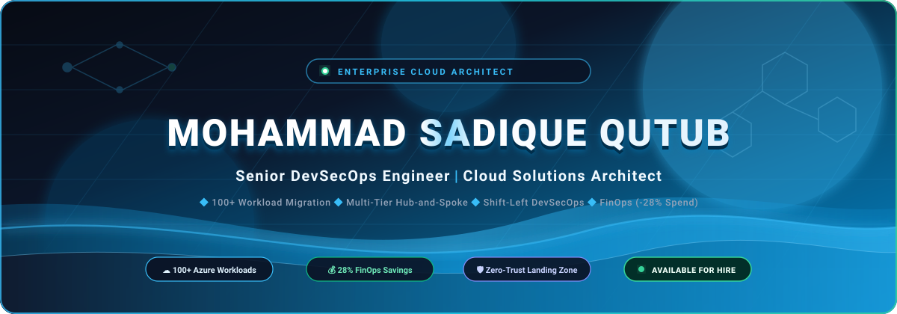

<div align="center">

<!-- 3D & ANIMATED HERO BANNER -->


<br/><br/>

### <samp><span style="color:#38bdf8;">Senior DevSecOps Engineer</span> &nbsp;|&nbsp; <span style="color:#0284c7;">Cloud Solutions Architect</span></samp>

<p align="center">
  <strong>🔐 Senior DevSecOps Engineer &amp; Cloud Architect | Enterprise Cloud Infrastructure</strong><br/>
  <em>Enterprise Cloud Infrastructure • Zero-Trust Security • GitOps Automation • Autonomous SRE • FinOps</em>
</p>

<!-- ACTION BADGES ROW (EXACT FORMAT MATCHING YOUR DESIGN) -->
<p align="center">
  <a href="https://www.linkedin.com" target="_blank"></a>
  <a href="https://github.com/sadiq84?tab=repositories" target="_blank"></a>
  <a href="mailto:mohd.sadiq84@gmail.com"></a>
  <a href="https://sadiq84.github.io/sadiq84/" target="_blank"></a>
</p>

<!-- TECH CERTIFICATIONS ROW -->
<p align="center">
  
  
  
  
  
</p>

```
  ========================================================================================
  [ ENTERPRISE IMPACT METRICS ]
  * 100+ Enterprise Workloads Migrated (Dev / UAT / Prod) with Zero Unplanned Downtime
  * 28% Total Cloud Operating Spend Reduced via Proactive FinOps & Rightsizing Governance
  * 100% Policy-Driven IaC Landing Zones with Automated Nightly Drift Detection
  ========================================================================================
```

</div>

---

## 📌 Executive Summary & Interview Dossier Context

This repository and [interactive portal](https://sadiq84.github.io/sadiq84/) serve as an enterprise-grade architectural blueprint and senior interview preparation dossier. It details the end-to-end design, execution, security governance, and financial management required for large-scale enterprise cloud transformations (100+ workloads) to Microsoft Azure.

> [!IMPORTANT]
> **Core Architectural Pillars Covered:**
> Enterprise Cloud Adoption Framework (CAF) • Multi-Tier Hub-and-Spoke Networking • Shift-Left DevSecOps (Checkov, GitLeaks, Trivy) • Terraform Automated Landing Zones • Defense-in-Depth Zero-Trust • 28% FinOps ROI • High Availability & Disaster Recovery (RTO/RPO) • Executive Vendor Governance (SOW, RACI).

---

## 🗺️ Table of Contents

1. [Professional Portfolio & Standing Out ("How to Look Unique?")](#1-professional-portfolio--standing-out-how-to-look-unique)
2. [IT Career Tracks & Roles Matrix](#2-it-career-tracks--roles-matrix)
3. [The Senior Mindset: Business & Architecture Alignment](#3-the-senior-mindset-business--architecture-alignment)
4. [Real-World Architecture Scenario: 100+ Application Migration & 10 Pillars](#4-real-world-architecture-scenario-100-application-migration)
5. [Enterprise Governance, Identity & Management Hierarchy](#5-enterprise-governance-identity--management-hierarchy)
6. [Enterprise Hub-and-Spoke Networking Architecture](#6-enterprise-hub-and-spoke-networking-architecture)
7. [Multi-Layered Defense-in-Depth Security](#7-multi-layered-defense-in-depth-security)
8. [Terraform Landing Zone Automation & Best Practices](#8-terraform-landing-zone-automation--best-practices)
9. [Azure Repos & DevSecOps Pipelines](#9-azure-repos--devsecops-pipelines)
10. [End-to-End Cloud Migration Strategy (5 Phases)](#10-end-to-end-cloud-migration-strategy)
11. [FinOps (Cloud Financial Management & 28% Spend Optimization)](#11-finops-cloud-financial-management)
12. [Backup, Disaster Recovery & High Availability](#12-backup-disaster-recovery--high-availability)
13. [Enterprise Observability & Monitoring](#13-enterprise-observability--monitoring)
14. [Vendor Management & Delivery Governance (SOW, RACI)](#14-vendor-management--delivery-governance)

---

### 1. Professional Portfolio & Standing Out ("How to Look Unique?")

In senior and lead-level interviews, candidates are evaluated not on memorized syntax, but on **strategic business understanding, architecture design, and technical leadership**.

```
                           [ How to Look Unique? ]
                                      |
                                [ Portfolio ]
                                      |
                     +----------------+----------------+
                     |                                 |
                [ Freshers ]                    [ Experienced ]
                     |                                 |
           (Syntax & Labs)                (Impact & Architecture)
                     |                                 |
                     +----------------+----------------+
                                      |
                               1. Resume (Impact & metrics-driven)
                               2. LinkedIn Profile (Thought leadership & networking)
                               3. Naukri.com / Job Portals (Optimized keywords)
                               4. GitHub.com (Production-grade IaC & CI/CD modules)
                               5. Personal Website / Technical Blog
```

#### Essential Portfolio Assets:
* **Resume (Impact & Metrics-Driven):** Highlight quantifiable ROI and scale: *"Architected zero-downtime migration of 100+ enterprise workloads to Azure, cutting cloud operating spend by 28% while sustaining a 99.99% multi-region SLA."*
* **LinkedIn Profile:** Thought leadership posts, Cloud Adoption Framework (CAF) retrospectives, and architecture breakdowns.
* **GitHub Repository:** Modular, production-ready Terraform modules with strict semantic versioning, Checkov security linting, Infracost automation, and reusable Azure DevOps YAML pipeline templates.
* **Personal Technical Blog / Website:** Real-world case studies, Architectural Decision Records (ADRs), and blameless post-mortems.

---

### 2. IT Career Tracks & Roles Matrix

```
+------------+       +---------------+       +---------+       +----------------------+       +----------------+
|   Sales    | ----> |   Pre-Sales   | ----> |   TAM   | ----> | Enterprise Architect | ----> | Technical Lead |
| Commercial |       | Techno-       |       | Tech    |       | Infra + Application  |       | Infra / App    |
| Focus      |       | Functional    |       | Account |       | Strategy & Design    |       | Execution      |
|            |       | Proposals     |       | Manager |       |                      |       |                |
+------------+       +---------------+       +---------+       +----------------------+       +----------------+
```

* **Sales:** Business development, lead origination, client relationship management.
* **Pre-Sales (Techno-Functional):** RFPs/RFIs responses, technical demonstrations, solution estimations, commercial proposals.
* **TAM (Technical Account Manager):** Trusted technical advisor, governance, operational escalations, account health.
* **Enterprise Architect:** Holistic technology blueprints spanning infrastructure, security, data, and application ecosystems.
* **Technical Lead:** Hands-on sprint execution, IaC reviews, architectural enforcement, mentor junior team members.

---

### 3. The Senior Mindset: Business & Architecture Alignment

A senior candidate must answer: *"What is the business? What is the functional domain? What are the SLA, RTO, and compliance constraints before writing a single line of Terraform?"*

```
                              [ Experienced Mindset ]
                                         |
                   "What is the Business & Functional Domain?"
                                         |
            +----------------------------+----------------------------+
            |                                                         |
[ Infrastructure Design & Implementation ]     [ Application System Design & Implementation ]
- Cloud Architecture & Landing Zones           - Microservices vs Monolith trade-offs
- DevSecOps & Infrastructure as Code           - API Gateways & Service Mesh (Envoy/Istio)
- Cloud Migration & App Modernization          - State, Session & Caching Strategy (Redis)
- Governance, Security, DR, FinOps             - Messaging & Event-Driven Patterns (Kafka/Bus)
```

#### Executive & Leadership Responsibilities:
1. **Leadership & Team Upskilling:** Running KT sessions, mentoring junior engineers, senior interview panels.
2. **Vendor & Service Management:** SOW negotiations, deliverable sign-offs, SLA/RACI tracking.
3. **Pre-Sales & Proposals:** Technical estimations, POC execution, RFP/RFI responses.
4. **Delivery Governance:** SOPs, incident retrospectives, architecture compliance.

---

### 4. Real-World Architecture Scenario: 100+ Application Migration

> [!NOTE]
> **Problem Statement:** Migrating 100+ enterprise workloads across Dev, UAT, and Production from an On-Premises Datacenter to Microsoft Azure with zero unplanned downtime and compliance assurance.

#### The 10 Scalability & Quality Pillars:
```
+--------------------------------------------------------------------------------------------------+
|                                    10 Scalability & Quality Pillars                               |
|                                                                                                  |
|  1. Scalable      2. Robust        3. Secure        4. Reliable       5. Portable                |
|  6. Governed      7. High Avail    8. Cost-Optim    9. Backed Up      10. Compliant & Monitored  |
+--------------------------------------------------------------------------------------------------+
```

1. **Scalable:** Auto-scaling via VMSS, AKS Horizontal Pod Autoscaling (HPA), and elastic App Service plans.
2. **Robust:** Graceful degradation, circuit breakers, and self-healing infrastructure.
3. **Secure:** Zero-Trust, PIM, CMK disk encryption, and Private Endpoints.
4. **Reliable:** Health probes, SLA-backed managed PaaS, and automated failovers.
5. **Portable:** Containerized workloads (Docker/OCI), Helm packaging, and modular IaC.
6. **Governed:** Azure Policy deny effects, Management Group hierarchy, and strict tagging taxonomy.
7. **High Availability:** Multi-Availability Zone deployment, ZRS storage, and active-active Front Door routing.
8. **Cost-Optimized:** Infracost in CI/CD, 3-year Reserved Instances, Savings Plans, and non-prod shutdown.
9. **Backed Up:** Azure Backup vaults, immutable storage tiers, and tested point-in-time recovery.
10. **Compliant & Monitored:** Azure Monitor Agent (AMA), Log Analytics, DCR filtering, and Action Groups.

---

### 5. Enterprise Governance, Identity & Management Hierarchy

#### Microsoft Cloud Adoption Framework (CAF) Methodology
Microsoft CAF guides end-to-end cloud adoption across six iterative phases:
* **Strategy:** Business justification and measurable ROI.
* **Plan:** Workload alignment, org structure, skill readiness.
* **Ready:** Landing zone preparation and identity foundation.
* **Adopt:** Migration and application modernization sprints.
* **Govern:** Azure Policy, guardrails, compliance benchmarks.
* **Secure & Manage:** Continuous monitoring, patching, threat protection.

#### Tenant & Management Group Hierarchy
```
                            [ Microsoft Entra ID Tenant ]
                                          |
                              [ Tenant Root Group ]
                                          |
         +--------------------------------+--------------------------------+
         |                                |                                |
[ Platform Management Group ]   [ Landing Zones (Workloads) ]    [ Decommissioned / Sandbox ]
   |-- Identity (AD/DNS)           |-- Corp (Internal Only)         |-- Sandbox MG
   |-- Management (Logs/Mon)       |-- Online (Public/DMZ)          `-- Decommissioned MG
   `-- Connectivity (Hub/Firewall) |-- Dev Subscriptions
                                   |-- UAT Subscriptions
                                   `-- Prod Subscriptions
```

* **Subscription Boundaries:** Separate subscriptions by environment (Dev, UAT, Prod) and function (Platform vs Application) to prevent noisy neighbors and isolate blast radiuses.
* **Azure Policy & Initiatives:** Assign built-in initiatives (e.g., CIS Azure Benchmark, MCSB) at Management Group level; enforce audit/deny effects with documented, time-bound policy exemptions.
* **RBAC & PIM:** Group-based RBAC with Microsoft Entra ID; enforce Privileged Identity Management (PIM) with just-in-time access and multi-stage approvals.

---

### 6. Enterprise Hub-and-Spoke Networking Architecture

```
                       [ On-Premises Datacenter ]
                                   |
                     (ExpressRoute / S2S VPN Gateway)
                                   |
+----------------------------------v----------------------------------+
|                   HUB VNet (Central Connectivity)                   |
|                                                                     |
|  +--------------------+   +-------------------+   +--------------+  |
|  | Azure Firewall /   |   | GatewaySubnet     |   | Private DNS  |  |
|  | NVA (Inspection)   |   | (VPN/ER Gateway)  |   | Zones        |  |
|  +---------+----------+   +-------------------+   +--------------+  |
+------------|--------------------------------------------------------+
             | (VNet Peering + UDR: 0.0.0.0/0 -> Firewall IP)
             +-----------------------+-----------------------+
             |                                               |
+------------v------------+                     +------------v------------+
|  Spoke 1: App VNet      |                     |  Spoke 2: Shared VNet   |
|  - App Tier Subnets     |                     |  - CI/CD Runners        |
|  - DB Tier Subnets      |                     |  - Bastion Host         |
|  - Private Endpoints    |                     |  - Security Tools       |
+-------------------------+                     +-------------------------+
```

* **IP Address Management (IPAM) & CIDR:** Comprehensive assessment of on-prem CIDRs to ensure zero overlapping address spaces with Azure VNets.
* **Centralized Traffic Inspection:** User Defined Routes (UDRs) forcing `0.0.0.0/0` and inter-spoke traffic through the Azure Firewall / Network Virtual Appliance (NVA).
* **Controlled Egress & Ingress:** Centralized Internet egress through firewall with TLS inspection; inbound traffic via Azure Application Gateway / Front Door with WAF.
* **Private Connectivity:** Private Endpoints for all PaaS services (Key Vault, Storage, SQL) with central Private DNS Zone resolution linked to the Hub.

---

### 7. Multi-Layered Defense-in-Depth Security

| Layer | Key Controls & Technologies | Implementation Strategy |
| :--- | :--- | :--- |
| **Identity Level** | Microsoft Entra ID, Conditional Access, Multi-Factor Authentication (MFA), Privileged Identity Management (PIM), Service Principals / Managed Identities. | Zero standing access; Just-in-Time privilege elevation; workload identities without stored secrets. |
| **Networking Level** | Hub-and-Spoke, Micro-segmentation via NSGs/ASGs, Azure Firewall Premium (IDPS), Private Endpoints, DDoS Protection Standard. | Complete perimeter isolation; all traffic inspected; zero public internet exposure on backend tiers. |
| **Governance Level** | Azure Policy enforcement, CIS / ISO27001 regulatory compliance benchmarks, Microsoft Defender for Cloud Secure Score. | Automated preventive guardrails (deny effects) applied at Management Group root. |
| **Compute Level** | Defender for Servers, automated vulnerability scanning, Disk Encryption with Customer Managed Keys (CMK), automated OS patch baselines. | Cryptographic disk isolation; automatic zero-day patch deployments; continuous agentless runtime security. |

---

### 8. Terraform Landing Zone Automation & Best Practices

```
[ Terraform Git Repo ] 
         |
         v
[ Linting (tflint) & Format (terraform fmt) ]
         |
         v
[ Security Scanning (tfsec / Checkov / Trivy) ]
         |
         v
[ Cost Estimation (Infracost) ]
         |
         v
[ Terraform Plan & Drift Detection Pipeline ]
         |
         v
[ Manual Peer Approval (Production Gate) ]
         |
         v
[ Terraform Apply (Remote State locked via Azure Blob Storage) ]
```

* **Remote State Management:** Remote state stored in private Azure Storage Account with blob lease locking, encrypted at rest, and accessed via Least Privilege Managed Identities.
* **Modularity:** Reusable, parameterized Terraform modules with strict semantic versioning.
* **Automated Drift Detection:** Scheduled night pipelines running `terraform plan -detailed-exitcode` to catch manual console changes immediately.

---

### 9. Azure Repos & DevSecOps Pipelines

* **Branching Strategy:** Trunk-based development with short-lived feature branches (`feature/*`, `fix/*`).
* **Branch Policies:**
  - Strict branch protection on `main`.
  - Mandatory Pull Request (PR) with minimum 2 senior reviewers.
  - Code owners (`CODEOWNERS`) file enforcement.
  - *"No Delete"* and *"No Direct Push"* on production branches.
* **YAML Pipeline Template Flow:**
  - **Validate & Test:** `terraform validate`, `tflint`, unit tests.
  - **Security & Secrets:** GitLeaks, Checkov, Trivy vulnerability scans.
  - **Build & Plan:** Generate plan artifact.
  - **Approval Gate:** Manual approval for UAT/Production.
  - **Deploy & Apply:** Execute deployment.
  - **Automated Rollback:** Automated failure rollback plan.
* **Custom Middleware Setup:** VM custom data / Cloud-Init scripts for baseline configuration and agent bootstrapping.

---

### 10. End-to-End Cloud Migration Strategy

```
+---------------+     +--------------+     +------------+     +-----------+     +-------------+
|   Discovery   | --> |  Assessment  | --> | Readiness  | --> |  Cutover  | --> |  Hypercare  |
| Inventory,    |     | Compatibility|     | Landing    |     | Downtime  |     | 24x7 War    |
| Dependencies  |     | & TCO ROI    |     | Zone Ready |     | Window    |     | Room Support|
+---------------+     +--------------+     +------------+     +-----------+     +-------------+
```

#### Migration Checklists:
* **Pre-Migration:** Discovery reports (Azure Migrate), dependency mapping, bandwidth sizing, target Landing Zone verification, backup verification.
* **During-Migration (Cutover):** Traffic rerouting, database replication sync, DNS TTL reduction to 300s, validation tests.
* **Post-Migration & Hypercare:** Health telemetry checks, end-user sanity testing, performance benchmarking, 2-4 weeks dedicated war room support.

---

### 11. FinOps (Cloud Financial Management)

> [!TIP]
> **28% Operating Cost Reduction Achieved Through:**

* **Eliminate Waste:** Detect and remove unattached managed disks, obsolete snapshots, unassociated public IPs, and idle compute instances.
* **Rightsizing:** Resize oversized VMs based on 30-day CPU/Memory utilization percentiles (P95).
* **Commitment Discounts:** Reserved Instances (1-year or 3-year RI) and Azure Savings Plans for steady-state workloads (up to 72% savings).
* **Automated Scheduling:** Automated start/stop for non-production environments outside business hours (65% compute savings on Dev/UAT).
* **Log Ingestion Tuning:** Review Azure Monitor log ingestion tables; configure Data Collection Rules (DCR) to filter noisy diagnostic logs at the source.

---

### 12. Backup, Disaster Recovery & High Availability

* **Storage Redundancy:**
  - **LRS (Locally Redundant Storage):** 3 copies within a single datacenter (11 9's durability).
  - **ZRS (Zone-Redundant Storage):** 3 copies across 3 availability zones in a region (12 9's durability).
  - **GRS (Geo-Redundant Storage):** Replicated to a secondary paired region for disaster recovery (16 9's durability).
* **High Availability Compute:** Virtual Machine Scale Sets (VMSS) across multiple Availability Zones.
* **RTO & RPO Definitions:**
  - **RTO (Recovery Time Objective):** Maximum acceptable duration of downtime before system is restored ($\le 30$ mins).
  - **RPO (Recovery Point Objective):** Maximum acceptable data loss measured in time ($\le 15$ mins transactional delta).
* **Region Strategy:** Primary active region with Azure Site Recovery (ASR) replicating to secondary paired region.

---

### 13. Enterprise Observability & Monitoring

* **Azure Monitor & Log Analytics:** Centralized Log Analytics Workspace per enterprise landing zone with automated cold storage archiving.
* **Azure Monitor Agent (AMA):** Ingestion filtered at source via Data Collection Rules (DCR) to optimize cost and performance.
* **Alerting & Escalation:** Action Groups routing alerts dynamically to Microsoft Teams channels, Slack, or PagerDuty for critical incidents with strict SLA escalation.

---

### 14. Vendor Management & Delivery Governance

Senior engineers and architects regularly evaluate, negotiate with, and govern external partners and vendors.

#### The Procurement & Governance Lifecycle:
```
[ RFI (Request for Information) ]
               |
[ RFP (Request for Proposal) ]
               |
[ Technical Evaluation Matrix (Architecture, Security, Cost) ]
               |
[ SOW (Statement of Work) & Commercials ]
               |
[ Project Sprints & Deliverable Milestones ]
               |
[ Acceptance Criteria Sign-Off & Payment Release ]
```

* **SOW (Statement of Work):** Formal legal and technical document detailing scope, deliverables, acceptance criteria, timeline, milestones, and liabilities.
* **Technical Evaluation Matrix:** Scoring vendors objectively against architecture capabilities (40%), security compliance (30%), past experience (15%), and pricing (15%).
* **RACI Matrix:**
  - **Responsible:** Who executes the task.
  - **Accountable:** The single individual answerable for deliverable completion.
  - **Consulted:** Subject matter experts providing input.
  - **Informed:** Stakeholders kept updated on progress.
* **Escalation Matrix:** Clearly defined escalation paths and SLAs when technical blockers or contract breaches occur.
* **Transition & Knowledge Transfer:** Formal documentation handover, runbooks, architecture walk-throughs, and shadowing before sign-off.

---

<div align="center">

### 🤝 Connect & Inquire
**Sadiq** • Senior DevOps & Cloud Solutions Architect  
[](mailto:mohd.sadiq84@gmail.com)
[](https://github.com/sadiq84)
[](https://sadiq84.github.io/sadiq84/)
[](https://www.linkedin.com)

</div>
